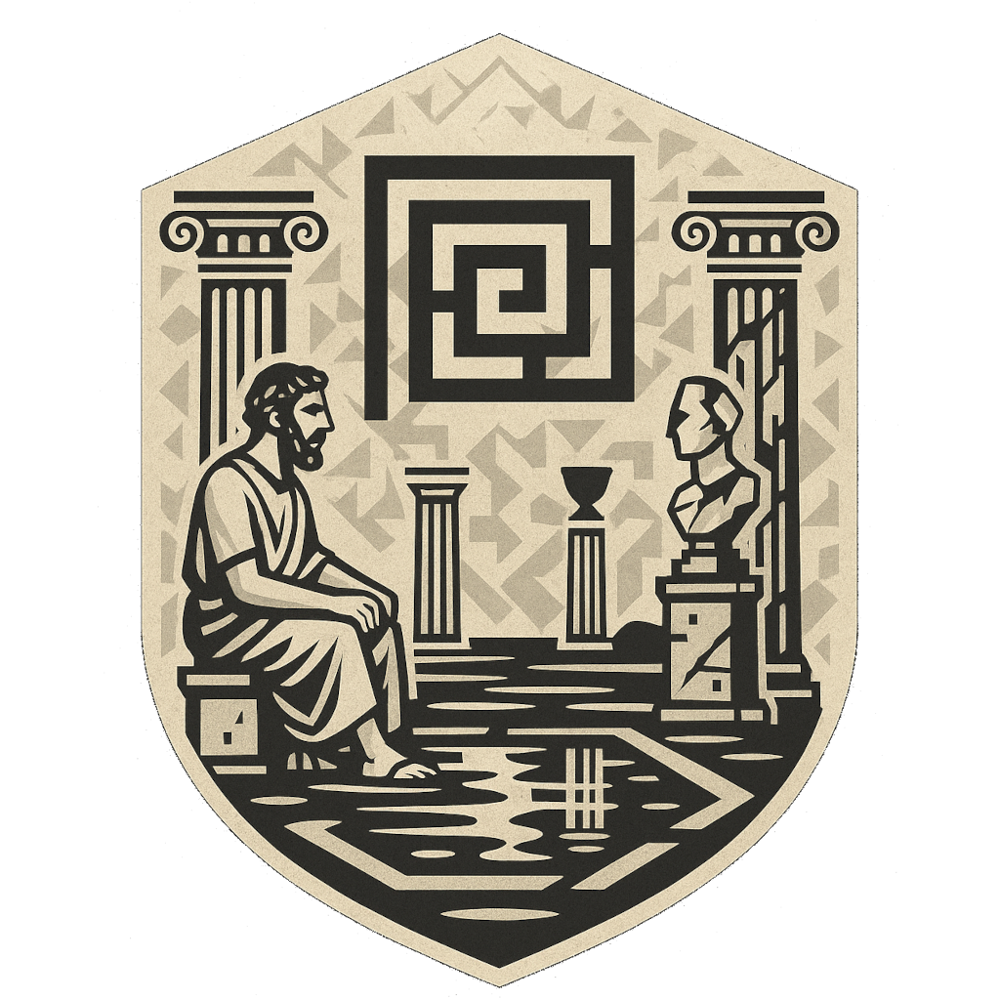

# Vue d'ensemble

Sept quartiers composent Éthéria. Chacun a son atmosphère propre, ses
habitants, ses lieux marquants et ses passages d'accès. Ce qui suit
donne, pour chaque quartier, ce qu'un joueur peut en percevoir en
l'explorant.

## Le Labyrinthe des Identités

{ width="120" }

Le quartier semble d'abord paisible : colonnades anciennes, fontaines
qui chantent sans s'arrêter, fresques qui bougent si on ne les regarde
pas trop longtemps. Puis le doute s'installe. Une ruelle apparaît là
où il n'y en avait pas hier. Un habitant vous salue par un nom que
vous ne portez pas. Les Rémanents, qui vivent ici, changent
régulièrement de nom et parfois de souvenir ; certains tiennent des
carnets où ils consignent ce qu'ils croient être, au cas où.

Lire la [fiche du quartier](labyrinthe-des-identites.md).

## La Concorde du Pacte

{ width="120" }

L'air y est plus clair, les voix mesurées : on y parle avant d'agir.
De vastes forums accueillent des débats permanents, jamais vraiment
clos. Les Liants, qui habitent le quartier, appartiennent chacun à un
Cercle de Délibération ; il n'y a pas d'autorité fixe, seulement des
représentants tirés au sort pour un temps limité.

Lire la [fiche du quartier](concorde-du-pacte.md).

## La Balance d'Orion

{ width="120" }

Tout y semble pesé, optimisé. Le silence est ponctué de mécanismes
invisibles ; des panneaux affichent en continu des courbes de bien
commun. Sous cette harmonie apparente, un malaise sourd : la douleur
n'est pas absente, seulement répartie avec soin. Les Maximisants, qui
y vivent, tiennent des carnets de conséquences et arbitrent leurs
choix en assemblée.

Lire la [fiche du quartier](balance-d-orion.md).

## Le Gouffre d'Absyr

{ width="120" }

Un brouillard pâle ne se lève jamais tout à fait. Les rues ne mènent
nulle part en particulier, les horloges tournent dans des sens
contraires. On n'y crie pas : on observe, on s'interroge, on renonce,
parfois avec une paix étrange. Les Déliés, qui habitent ici, ont tous
abandonné quelque chose, un but, une foi, une illusion.

Lire la [fiche du quartier](gouffre-d-absyr.md).

## Les Rails de la Décision

{ width="120" }

Des rails sombres serpentent entre les bâtiments, parfois suspendus
dans le vide. Chaque croisement porte une histoire non résolue ; la
lumière change selon les décisions prises, douce tant que rien n'est
tranché, crue dès qu'on agit. Les Aiguilleurs, formés dès l'enfance à
trancher vite, portent souvent une marque visible de leurs choix
passés.

Lire la [fiche du quartier](rails-de-la-decision.md).

## Les Jardins de l'Équité

{ width="120" }

Un calme mesuré y règne : chemins symétriques, fontaines aux bassins
jumeaux, lumière dosée avec soin. On ne s'y presse pas, mais on n'y
stagne pas non plus. Sous cette perfection, une tension sommeille :
toute règle, même juste, laisse des exclus. Les Arbitres, ou
Équilibrés, consacrent leur vie à l'art difficile de la juste
mesure plutôt qu'à l'égalité brute.

Lire la [fiche du quartier](jardins-de-l-equite.md).

## La Citadelle de l'Arété

{ width="120" }

Un calme profond s'installe à mesure qu'on approche. On n'y court
pas : on y marche avec détermination, observé non pour être jugé,
mais pour être compris à l'aune de sa constance. Bâtie en terrasses,
chaque palier abrite un lieu dédié à une qualité de caractère. Les
Pratiquants, qui y vivent, refusent les masques et cherchent la
cohérence entre pensée, parole et action.

Lire la [fiche du quartier](citadelle-de-l-arete.md).
