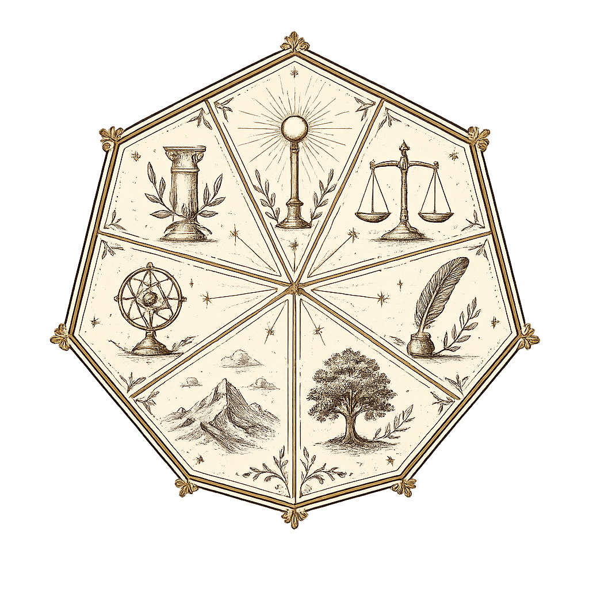

# Éthéria, la Cité des Concepts

  

Éthéria est un jeu de rôle. On y incarne des Aventuriers de la
Société des Explorateurs, dans une cité où chaque quartier pose une
question de philosophie et ne laisse repartir personne sans un choix.
On y enquête, on y débat, on y tranche, et la cité garde la trace de
ce qu'on a décidé.

Le moteur est Fate Accelerated. Les scénarios publiés se jouent à
un meneur de jeu (MJ) et trois à cinq joueurs, en deux à trois
heures.

## Ce qu'il faut pour jouer

- Quatre dés Fate (dés Fudge) par joueur, ou un seul jeu qui tourne.
- Trois jetons de points de Destin par joueur, plus une réserve pour
  le MJ.
- Une [Fiche d'Aventurier](jouer/creer-un-aventurier.md) par joueur,
  à remplir, ou un [prétiré](jouer/pretires.md).
- Les cartes de [sécurité de table](jouer/securite-de-table.md).
- Pour le MJ, un [scénario](scenarios/index.md). Chacun a son kit à
  imprimer, qui réunit tout ce qui précède sauf les dés et les
  jetons.

Pour jouer ce soir : [Le Huitième Fragment](scenarios/le-huitieme-fragment.md),
scénario d'initiation, s'explique en même temps qu'il se joue.

## Comment lire ce livre

| Partie | Pour qui | Ce qu'on y trouve |
| --- | --- | --- |
| [Présentation](presentation.md) | Tout le monde | Le ton, les thèmes, ce que les joueurs incarnent |
| [I. La cité](cite/introduction.md) | Tout le monde | Éthéria, son histoire, ses figures, ses sept quartiers |
| [II. Jouer](jouer/regles-de-base.md) | Tout le monde | Les règles, la création d'un Aventurier, la sécurité de table |
| [III. Mener](mener/index.md) | Le MJ | Mise en scène, dilemmes, conséquences, oppositions |
| [IV. Campagne](campagne/index.md) | Le MJ | Trente-cinq trames, quartier par quartier, et de quoi les relier |
| [V. Scénarios](scenarios/index.md) | Le MJ | Sept scénarios en une séance, avec leurs kits |
| [Annexes](annexes/glossaire.md) | Tout le monde | Glossaire, lexique philosophique, auteurs, cartes à imprimer |

> [!MJ] Tu comptes jouer, pas mener ?
> Arrête-toi à la fin de la partie II. Les parties III à V donnent les
> ressorts des aventures et leurs dénouements.

Le jeu est encore en écriture. Les scénarios n'ont pas été testés en
partie, et le [changelog](https://spigushe.github.io/etheria-cite-concepts/changelog/) suit ce qui change d'une
version à l'autre.
