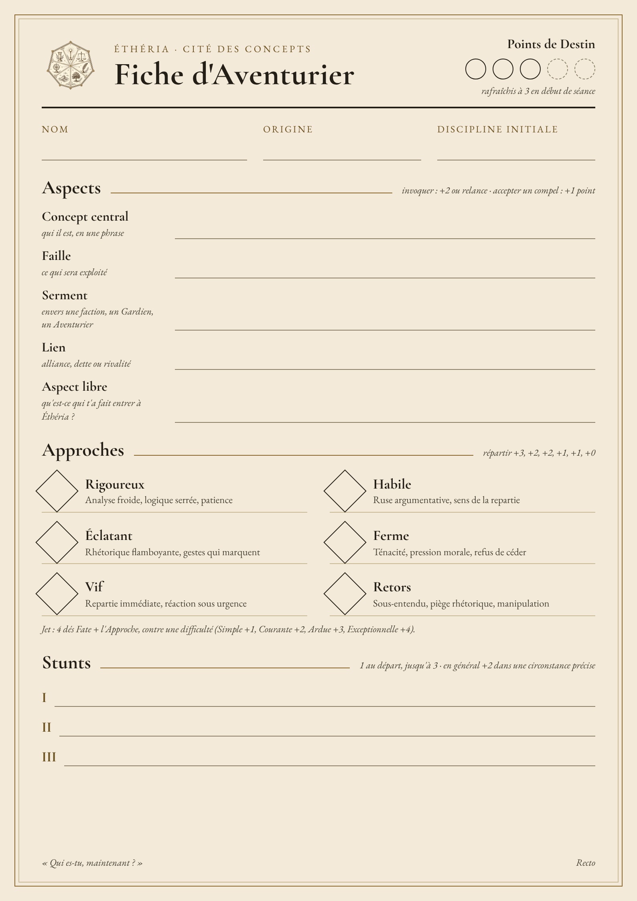
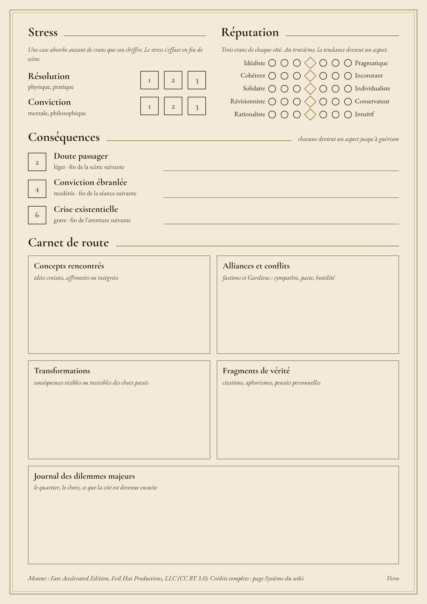

<!-- markdownlint-disable MD060 -->
<!--
  MD060 (alignement des tableaux) désactivé pour ce fichier : la
  combinaison compact + aligned_delimiter de .markdownlint.json produit
  des faux positifs dès qu'une cellule contient du gras ou de
  l'italique (largeur calculée différemment selon le contrôle).
  Testé et confirmé sur ce fichier le 2026-07-12.
-->

# La Fiche d'Aventurier

Cette page accompagne la Fiche d'Aventurier, une page A4 recto verso.
Elle suit la fiche zone par zone, dans l'ordre où on la remplit : quoi
écrire, où, et ce qui changera en cours de jeu.

## La fiche à imprimer

[Télécharger la Fiche d'Aventurier (PDF)](https://spigushe.github.io/etheria-cite-concepts/assets/fiches/fiche-aventurier.pdf).
Imprime-la en recto verso et remplis-la au crayon : presque tout ce
qui y figure est appelé à bouger.

{ .zoomable width="49%" loading=lazy }
{ .zoomable width="49%" loading=lazy }

Pour jouer tout de suite, dix [prétirés](pretires.md) ont déjà leur
fiche remplie.

> [!REGLE] Pourquoi FATE ici
> FATE ne teste presque jamais une action par défaut : on lance les dés
> seulement quand l'issue est incertaine et que l'enjeu compte
> vraiment (un Gardien qu'on cherche à convaincre, une épreuve du
> Pont des Paradoxes). Le reste (la plupart des dilemmes, des
> discussions, des choix de conscience) se joue à la table, sans jet.
> Les dés, les difficultés, les points de Destin et le stress sont
> expliqués dans les [règles de base](regles-de-base.md).

## Créer un Aventurier

Sept étapes, une dizaine de minutes. Chacune renvoie à la zone de la
fiche qu'elle remplit.

1. Choisis une Origine et une Discipline, et donne un nom à ton
   personnage : [l'en-tête](#nom-origine-discipline).
2. Écris le Concept central et la Faille : [les Aspects](#aspects).
3. Écris un Serment et un Lien, chacun envers une faction, un Gardien
   ou un autre Aventurier : [Serment et Lien](#serment-et-lien).
4. Laisse l'Aspect libre en blanc. Tu le rempliras en jeu.
5. Répartis +3, +2, +2, +1, +1 et +0 entre les six
   [Approches](#approches).
6. Écris un [stunt](#stunts). Les deux autres lignes restent vides.
7. Au verso, place ta réputation : deux axes à un cran du centre.

Le reste du verso (stress, conséquences, carnet de route) reste vierge
à la création.

## Recto

### Nom, Origine, Discipline

L'**Origine** dit d'où vient le personnage avant Éthéria, en quelques
mots : _une université qu'elle a quittée en claquant la porte_, _un
bourg où il a arbitré vingt ans de querelles_. La **Discipline
initiale** est le terrain où il a appris à penser : logique, éthique,
métaphysique, politique...

Ni l'une ni l'autre n'a d'effet chiffré. Elles servent à écrire les
Aspects qui suivent : commence par elles, le reste vient plus vite.

### Points de Destin

Rien à écrire ici : pose trois jetons sur la fiche, ou coche au
crayon les trois cercles pleins. Tu repars à 3 au début de chaque
séance. Les deux cercles en pointillé accueillent les points gagnés
au-delà de 3 pendant la séance.

Un point se dépense pour invoquer un aspect et se gagne en acceptant
un _compel_, une complication que le MJ propose à partir de l'un de
tes aspects (voir les [règles de base](regles-de-base.md)).

### Aspects

Un aspect est une phrase courte qui dit quelque chose de vrai sur le
personnage. Un bon aspect sert dans les deux sens : tu peux l'invoquer
quand il t'aide, et le MJ peut le compeller quand il te complique la
vie. S'il ne peut que t'aider, réécris-le.

| Ligne de la fiche | Quoi écrire | Exemple (prétirés) |
| ------------------- | ------------------------------------------------------------------------------- | ----------------------------------------------- |
| **Concept central** | Qui est le personnage, en une phrase | _Logicienne qui ne supporte pas l'à-peu-près_ |
| **Faille** | Une contradiction ou une faiblesse récurrente, qui _sera_ exploitée | _Je cède pour que ça s'arrête_ |
| **Serment** | Un engagement pris envers une faction, un Gardien ou un autre Aventurier | _Ne jamais signer ce que je n'ai pas vérifié_ |
| **Lien** | Une alliance, une dette ou une rivalité avec une faction, un Gardien ou un autre Aventurier | _J'ai une dette envers les Harmonistes_ |
| **Aspect libre** | Laissé en blanc à la création | (en jeu) |

L'**Aspect libre** se remplit pendant la première séance, en
répondant à la question imprimée sur la fiche : qu'est-ce qui t'a
fait entrer à Éthéria ? Il se réécrit ensuite à mesure que le
personnage change.

Écris la Faille à la première personne si ça t'aide : c'est l'aspect
que le MJ viendra chercher le plus souvent, donc ta première source de
points de Destin.

### Serment et Lien

Ces deux aspects rattachent le personnage à la cité. Le Serment dit
ce qu'il s'est engagé à faire, le Lien dit qui compte pour lui. Sans
eux, il traverse les quartiers en visiteur ; avec eux, chaque dilemme
risque de lui coûter quelque chose.

**Le Serment** est une promesse qui engage, écrite comme une règle de
conduite ou comme une tâche à accomplir :

- une règle qu'il s'impose : _Ne jamais décider à la place de
  quelqu'un d'autre_, _Plaider pour qui n'a personne pour le faire_ ;
- une promesse faite à quelqu'un : _J'ai promis à un Rémanent de lui
  rapporter son ancien nom_ ;
- une mission reçue d'une faction : _Rapporter aux Sentinelles du
  Pacte Originel toute trace d'un accord oublié_.

Un bon Serment peut être tenu ou trahi dans une scène précise. « Être
juste » ne se trahit jamais clairement ; _Ne jamais signer ce que je
n'ai pas vérifié_ se heurte à la première arche qui demande une
signature. Quand une situation le met à l'épreuve, le MJ propose un
compel : si tu acceptes la complication (tenir ta parole au prix
fort, ou la rompre et en porter la suite), tu gagnes un point de
Destin ; si tu la refuses, tu en paies un et tu trouves une issue qui
ménage ton Serment. Tu peux aussi l'invoquer chaque fois que tu agis
pour le tenir.

**Le Lien** est une relation en cours avec quelqu'un que le
personnage recroisera : un [courant ou un Gardien](../cite/personnages.md),
une figure d'un quartier, ou un autre Aventurier de la table. Il
nomme toujours quelqu'un, et il dit où en est la relation :

- une alliance : _Les Réviseurs me comptent déjà parmi eux_ ;
- une dette : _J'ai une dette envers les Harmonistes_ ;
- une rivalité ou un compte à régler : _J'ai confié une note à Camüs,
  et je voudrais la reprendre_.

Les meilleurs Liens laissent une question ouverte, que le jeu se
chargera de résoudre : _Le Collecteur a une fiche à mon nom, que je
n'ai pas osé lire_. Un Lien avec un autre Aventurier s'écrit avec
l'accord de son joueur, et donne tout de suite au groupe une raison
de voyager ensemble.

Les deux se réécrivent en fin d'aventure, comme tout aspect : un
Serment tenu jusqu'au bout, rompu ou devenu intenable en appelle un
nouveau, et un Lien change de nature quand la dette est payée ou
l'alliance trahie.

### Approches

Pas de compétences classiques : six façons d'aborder une action,
transposables à n'importe quelle situation (débat, filature, épreuve
symbolique). Inscris une valeur dans chaque losange : un +3, deux +2,
deux +1 et un +0.

| Approche | Ce qu'elle couvre à Éthéria |
| ------------- | -------------------------------------------- |
| **Rigoureux** | Analyse froide, logique serrée, patience |
| **Habile** | Ruse argumentative, sens de la repartie |
| **Éclatant** | Rhétorique flamboyante, gestes qui marquent |
| **Ferme** | Ténacité, pression morale, refus de céder |
| **Vif** | Repartie immédiate, réaction sous urgence |
| **Retors** | Sous-entendu, piège rhétorique, manipulation |

Le +3 va à la manière dont ton personnage s'y prend quand il ne
réfléchit pas, le +0 à celle qu'il évite. Une Approche décrit une
façon de faire, pas un domaine : le même argument peut se défendre en
Rigoureux ou en Éclatant, et c'est ta description qui tranche.

La ligne sous les Approches rappelle le jet : 4 dés Fate + l'Approche,
contre une difficulté de +1 à +4.

### Stunts

Un stunt donne un bonus (+2 en général) dans une circonstance précise,
ou une capacité spéciale. Remplis la ligne I à la création ; les
lignes II et III se gagnent en cours de jeu.

Le plus simple est de suivre la formule : un nom, puis « +2 en
_Approche_ pour _faire telle chose_ dans _telle circonstance_ ».
Exemples adaptés à l'univers :

- _Dialecticien_ : +2 en Habile pour dénouer la contradiction logique d'un PNJ.
- _Lecture des Gardiens_ : +2 en Rigoureux pour interpréter l'allégorie d'un Gardien.
- _Voix du silence_ : +2 en Ferme pour tenir une position sans un mot, face à une pression collective.

Si la circonstance se présente à chaque scène, le stunt est trop
large ; si elle ne se présente jamais, il est trop étroit.

## Verso

### Stress

Deux pistes plutôt qu'une santé unique, pour distinguer l'épreuve
physique de l'épreuve intellectuelle ou existentielle propre à
Éthéria : **Résolution** (physique, pratique) et **Conviction**
(mentale, philosophique).

Rien à remplir à la création. En jeu, quand une attaque t'inflige des
crans, coche une case de la piste concernée : une case absorbe autant
de crans que le chiffre qu'elle porte (1, 2 ou 3). On ne coche qu'une
case par attaque. Efface tout en fin de scène.

### Réputation

Cinq axes de sept positions : le losange central, et trois cercles de
chaque côté. À la création, choisis deux axes et noircis sur chacun
le premier cercle à côté du losange, du côté qui ressemble à ton
personnage. Sur les trois autres axes, noircis le losange.

```text
Idéaliste     ○ ○ ○ ◇ ○ ○ ○ Pragmatique
Cohérent      ○ ○ ● ◇ ○ ○ ○ Inconstant
Solidaire     ○ ○ ○ ◆ ○ ○ ○ Individualiste
Révisionniste ○ ○ ○ ◆ ○ ○ ○ Conservateur
Rationaliste  ○ ○ ● ◇ ○ ○ ○ Intuitif
```

_Exemple : un personnage à un cran vers Cohérent et un cran vers
Rationaliste, au centre ailleurs._

En jeu, quand un axe bouge, gomme et noircis la nouvelle position. Au
troisième cran d'un côté, note à côté de l'axe l'aspect que tu gagnes.
Ce qui fait bouger un axe est expliqué dans
[Réputation philosophique](reputation.md).

### Conséquences

Quand le stress ne suffit pas, une conséquence absorbe davantage,
mais laisse une trace. Coche la case (son chiffre est le nombre de
crans absorbés) et écris sur la ligne ce que le coup a laissé : cette
phrase devient un aspect, que n'importe qui peut invoquer ou
compeller jusqu'à guérison.

| Conséquence | Absorbe | S'efface à | Exemple d'aspect à écrire |
| ----------------------------- | ------- | ----------------------------- | ------------------------------------ |
| Doute passager (léger) | 2 crans | la fin de la scène suivante | _Ébranlé par l'argument du Gardien_ |
| Conviction ébranlée (modérée) | 4 crans | la fin de la séance suivante | _Ne croit plus à sa propre cause_ |
| Crise existentielle (grave) | 6 crans | la fin de l'aventure suivante | _A perdu le sens de qui il est_ |

Chaque ligne ne sert qu'une fois tant qu'elle n'est pas effacée.

### Carnet de route

Cinq cadres vides à la création. Ils n'ont pas d'effet chiffré : ils
gardent la mémoire du personnage d'une séance à l'autre, et donnent
de la matière pour réécrire un aspect ou justifier un déplacement de
réputation.

- **Concepts rencontrés :** les idées croisées, affrontées ou intégrées. Une ligne par idée, avec le quartier où tu l'as rencontrée.
- **Alliances et conflits :** les factions et les Gardiens, avec la nature du lien (sympathie, pacte, hostilité).
- **Transformations :** les conséquences visibles ou invisibles des choix passés, y compris les conséquences guéries qui ont laissé une marque.
- **Fragments de vérité :** citations, aphorismes, pensées personnelles, à ressortir en jeu comme ressource narrative.
- **Journal des dilemmes majeurs :** pour chaque dilemme, le quartier, le choix fait, et ce que la cité est devenue ensuite.

## Ce qui change, et quand

Presque tout sur la fiche est appelé à bouger. Le tableau de ce qui se
modifie, et à quel moment, est dans
[Évolution des personnages](evolution.md).
