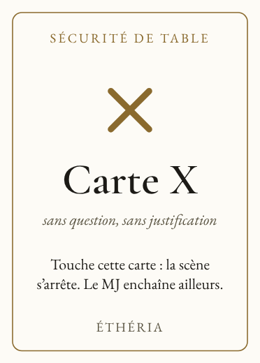
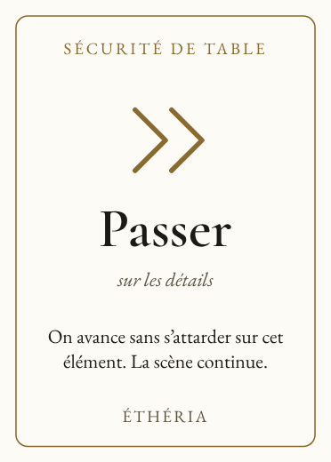
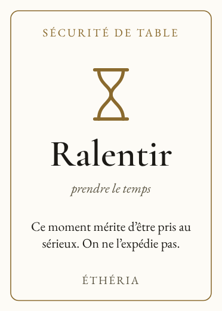
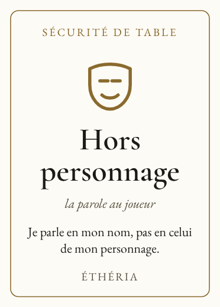
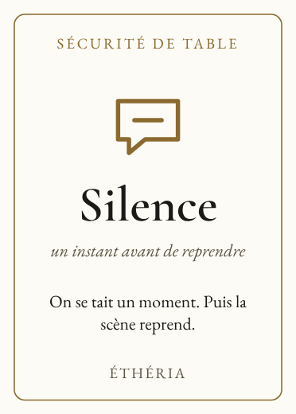
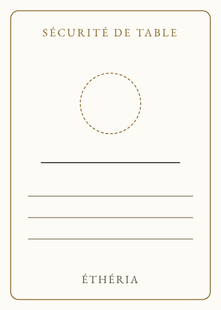
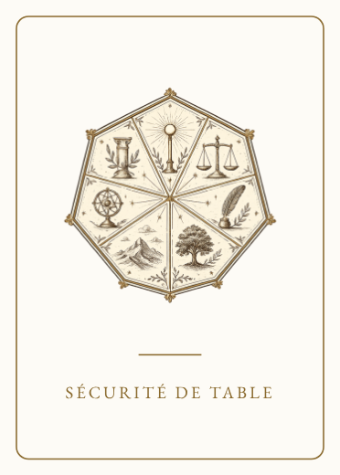

# Sécurité de table

> [!REGLE] La Carte-X et les signaux de table
> Éthéria manipule des thèmes lourds : deuil, sacrifice, perte
> d'identité, suicide assisté à la Balance d'Orion, enfants en danger
> aux Rails de la Décision. Chaque trame d'aventure indique ses thèmes
> sensibles. Voici un outillage minimal, à ajuster selon la table.

Avant la première séance, présente rapidement les thèmes récurrents du
jeu (dilemmes moraux, absurde, deuil symbolique) et demande si
certains sujets doivent être évités ou traités avec prudence.

L'outil principal reste la Carte-X : un mot ou un geste convenu à
l'avance, qui coupe immédiatement une scène sans qu'on ait à se
justifier. Le MJ y répond sans poser de question et enchaîne ailleurs.
Mais couper entièrement une scène est parfois plus radical que
nécessaire, alors trois signaux plus légers permettent d'ajuster sans
en arriver là. Un joueur peut demander de passer sur les détails,
pour avancer sans s'attarder sur un élément précis plutôt que de tout
interrompre. Il peut aussi demander de ralentir, quand un moment
mérite d'être pris au sérieux plutôt qu'expédié. Ou simplement
demander la parole hors personnage, ou à l'inverse un instant de
silence avant de reprendre.

Ces signaux existent aussi en cartes, avec la Carte X et une carte
libre à remplir selon la table :
[toutes les cartes de sécurité à imprimer](https://spigushe.github.io/etheria-cite-concepts/assets/fiches/cartes-securite.pdf)
(quatre pages A4 en recto verso, trois exemplaires de chaque carte au
format 63 × 88 mm, dos commun).

<button class="carte-carrousel__prec" aria-label="Précédent">‹</button>

<button class="carte-carrousel__suivant" aria-label="Suivant">›</button>

Vérifie brièvement en fin de séance que tout le monde va bien,
surtout après une scène impliquant une perte d'identité ou un
sacrifice au sens propre. Un simple tour de table suffit la plupart
du temps.
