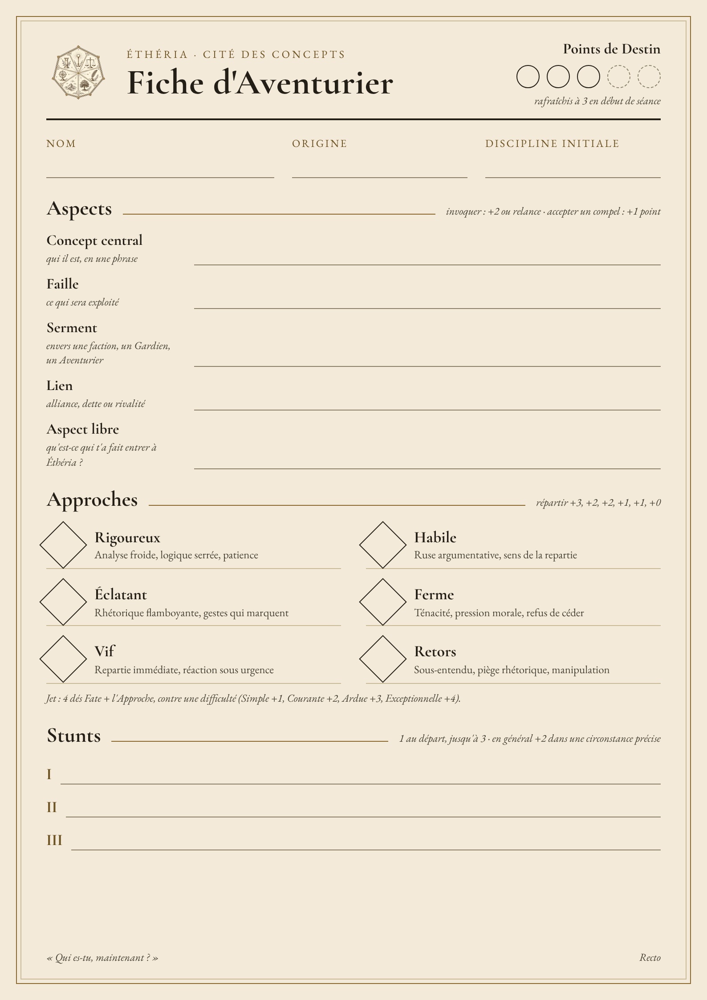
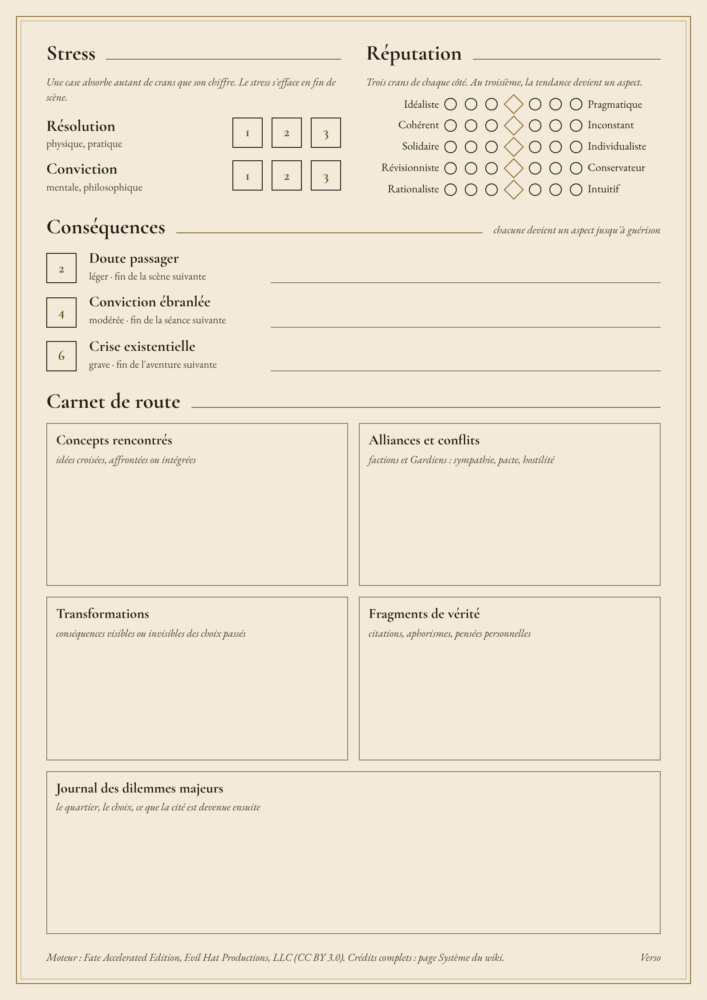

<!-- markdownlint-disable MD060 -->
<!--
  MD060 (alignement des tableaux) désactivé pour ce fichier : la
  combinaison compact + aligned_delimiter de .markdownlint.json produit
  des faux positifs dès qu'une cellule contient du gras ou de
  l'italique (largeur calculée différemment selon le contrôle).
  Testé et confirmé sur ce fichier le 2026-07-12.
-->

# Fiche de personnage : Aventurier Philosophe (FATE)

## Fiche imprimable

La fiche ci-dessous existe en version à imprimer, une page A4 recto
verso : [télécharger le PDF](../../assets/fiches/fiche-aventurier.pdf).

{ width="49%" loading=lazy }
{ width="49%" loading=lazy }

> [!REGLE] Pourquoi FATE ici
> FATE ne teste presque jamais une action par défaut : on lance les dés
> seulement quand l'issue est incertaine et que l'enjeu compte
> vraiment (un Gardien qu'on cherche à convaincre, une épreuve du
> Pont des Paradoxes). Le reste (la plupart des dilemmes, des
> discussions, des choix de conscience) se joue à la table, sans jet,
> exactement comme le prévoyait déjà [Système de jeu](../systeme.md).
> FATE ajoute une mécanique là où il en manquait une, sans changer
> l'esprit du jeu. Les règles de base (dés, difficultés, points de
> Destin, stress) sont dans [Système de jeu](../systeme.md#regles-de-base).

## Créer un Aventurier

1. Choisis une Origine et une Discipline. Elles n'ont pas d'effet
   chiffré : elles servent à écrire les Aspects.
2. Écris le Concept central et la Faille.
3. Écris un Serment et un Lien, chacun envers une faction, un Gardien
   ou un autre Aventurier.
4. Laisse l'Aspect libre en blanc. Tu le rempliras en jeu, en
   répondant à la question : qu'est-ce qui t'a fait entrer à Éthéria ?
5. Répartis +3, +2, +2, +1, +1 et +0 entre les six Approches.
6. Choisis un stunt. Tu pourras en ajouter deux en cours de jeu.
7. Place ta réputation : deux axes à un cran du centre.

Pour jouer tout de suite, cinq [prétirés](pretires.md) sont prêts.

## Recto : identité et Aspects

**Nom :** ___________________ **Origine :** ___________________
**Discipline initiale :** (logique, éthique, métaphysique...) ___________________

Les Aspects sont des phrases qui décrivent qui est le personnage. On
peut les _invoquer_ (dépenser un point de Destin pour un bonus, ou
relancer, quand l'aspect aide) ou se les faire _compeller_ (le MJ
propose une complication liée à l'aspect ; l'accepter donne un point
de Destin).

| Aspect | Description |
| -------------------- | --------------------------------------------------------------------------------- |
| **Concept central** | Qui est le personnage en une phrase (ex : _stoïcien errant, empiriste éclairé_)   |
| **Faille** | Une contradiction ou une faiblesse récurrente qui _sera_ exploitée |
| **Serment ou pacte** | Un engagement pris envers une faction, un Gardien, ou un autre joueur |
| **Lien** | Une relation marquante (alliance, dette, rivalité) avec une faction, un Gardien, ou un autre Aventurier |
| **Aspect libre** | Évolue en jeu ; se réécrit à mesure que le personnage change |

**Points de Destin :** ⬜⬜⬜ (rafraîchis à 3 en début de séance)

## Approches

Pas de compétences classiques : six façons d'aborder une action,
transposables à n'importe quelle situation (débat, filature, épreuve
symbolique). Répartition de départ : +3, +2, +2, +1, +1, +0.

| Approche | Ce qu'elle couvre à Éthéria | Score |
| ------------- | -------------------------------------------- | ----- |
| **Rigoureux** | Analyse froide, logique serrée, patience | ⬜ |
| **Habile** | Ruse argumentative, sens de la repartie | ⬜ |
| **Éclatant** | Rhétorique flamboyante, gestes qui marquent | ⬜ |
| **Ferme** | Ténacité, pression morale, refus de céder | ⬜ |
| **Vif** | Repartie immédiate, réaction sous urgence | ⬜ |
| **Retors** | Sous-entendu, piège rhétorique, manipulation | ⬜ |

> [!REGLE] Quand lancer les dés
> Un jet suppose 4 actions possibles : _Surmonter_ un obstacle,
> _Créer un avantage_ (poser un aspect de situation), _Attaquer_,
> _Défendre_. En dehors de ces cas à enjeu réel, on ne lance rien :
> on décrit, et ça se passe.

## Stunts (1 au départ, jusqu'à 3)

Un stunt donne un bonus (+2 en général) dans une circonstance précise,
ou une capacité spéciale. Exemples adaptés à l'univers :

- _Dialecticien_ : +2 en Habile pour dénouer la contradiction logique d'un PNJ.
- _Lecture des Gardiens_ : +2 en Rigoureux pour interpréter l'allégorie d'un Gardien.
- _Voix du silence_ : +2 en Ferme pour tenir une position sans un mot, face à une pression collective.

Stunts du personnage :

1. _______________________________________________
2. _______________________________________________
3. _______________________________________________

## Verso : résistance et conséquences

Deux pistes de stress plutôt qu'une santé unique, pour distinguer
l'épreuve physique de l'épreuve intellectuelle/existentielle propre à
Éthéria :

**Résolution** (physique, pratique) : ⬜ 1 ⬜ 2 ⬜ 3
**Conviction** (mentale, philosophique) : ⬜ 1 ⬜ 2 ⬜ 3

Une case absorbe autant de crans que le chiffre qu'elle porte. Le
stress s'efface en fin de scène.

Les conséquences absorbent plus de stress mais laissent une trace
durable, qui devient elle-même un aspect exploitable jusqu'à guérison :

| Conséquence | Case | Absorbe | Dure jusqu'à | Devient l'aspect |
| ----------------------------- | ---- | ------- | ------------------------------- | ------------------------------------------ |
| Doute passager (léger) | ⬜ | 2 crans | la fin de la scène suivante | _ex : "Ébranlé par l'argument du Gardien"_ |
| Conviction ébranlée (modérée) | ⬜ | 4 crans | la fin de la séance suivante | _ex : "Ne croit plus à sa propre cause"_ |
| Crise existentielle (grave) | ⬜ | 6 crans | la fin de l'aventure suivante | _ex : "A perdu le sens de qui il est"_ |

> [!REGLE] Lien avec la réputation philosophique
> La réputation philosophique (voir plus bas) se compte en crans,
> trois de chaque côté du centre, et elle a une vraie prise mécanique : agir à
> rebours de sa tendance actuelle est une occasion de _compel_ (un
> point de Destin contre une complication cohérente avec le
> personnage), et agir en accord profond avec elle peut justifier
> d'invoquer un aspect existant sans qu'il soit écrit noir sur blanc.

## Réputation philosophique

Cinq axes de sept positions chacun (le centre, et trois crans de
chaque côté), réévalués en fin de séance à la lumière des actes (pas
des intentions). Voir [Système de jeu](../systeme.md#reputation-philosophique)
pour le placement de départ et les déplacements.

```text
Idéaliste     ○ ○ ○ ● ○ ○ ○ Pragmatique
Cohérent      ○ ○ ○ ● ○ ○ ○ Inconstant
Solidaire     ○ ○ ○ ● ○ ○ ○ Individualiste
Révisionniste ○ ○ ○ ● ○ ○ ○ Conservateur
Rationaliste  ○ ○ ○ ● ○ ○ ○ Intuitif
```

## Pages centrales : carnet de route

- **Concepts rencontrés :** idées croisées, affrontées ou intégrées.
- **Alliances et conflits :** liens avec les factions et les Gardiens (nature du lien : sympathie, pacte, hostilité).
- **Transformations :** conséquences visibles ou invisibles des choix passés.
- **Fragments de vérité :** citations, aphorismes, pensées personnelles, utilisables comme ressource narrative.
- **Carte mentale personnalisée d'Éthéria** et **journal des dilemmes majeurs.**
